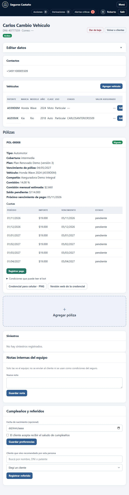

# Revisión funcional — Seguros Castaño

**5 de noviembre de 2026 · Rama de entrega: integrar-backend**

Se descargó `origin/main` al comenzar y se volvió a consultar al cerrar: **1cbe23d**, con la colaboración del grupo del PR #10 incluida. Se conservan esos aportes. Esta revisión no crea PR, no se fusiona a main y no despliega producción.

## Método y resultado

Se hicieron dos pasadas: correcciones de los recorridos principales y nueva revisión de las pantallas junto con el backend. Instalación, esquema y cuentas se prepararon técnicamente en PostgreSQL aislado. Los datos de negocio de aceptación se crearon y operaron desde el frontend con cuentas normales: no se completaron pasos faltantes con SQL, shell de Django o llamadas directas a APIs.

La entrada del cliente se simuló con `simular_whatsapp`, atravesando el procesamiento del proyecto. No es una pantalla del asesor. Todos los datos son ficticios. **No se enviaron mensajes reales ni se modificó producción.** Las pruebas técnicas usan otra base separada y complementan los recorridos por pantalla.

## Errores corregidos

| Área | Corrección |
|---|---|
| Interesados → póliza | El registro de la oferta elegida incluye plan compatible, condiciones, cuotas y etapa en la misma transacción. |
| Interesados → vehículo | Vínculo estable: editar patente/modelo no crea otro vehículo al emitir. La propuesta consulta los datos actuales de Clientes. |
| Interesados → contrato | Vínculo explícito con la póliza registrada; validar titular/vehículo y evitar usar un contrato para dos propuestas. |
| Contrato ya cargado | «Usar póliza ya registrada» termina la venta sin duplicar póliza ni cuotas. |
| Propuesta cerrada | No seguir editando ofertas y datos de ventas emitidas; conservación del historial. |
| Alta por chat | Al aprobar se vinculan cliente, vehículo y contrato y se completa el interesado del mismo vehículo. |
| Preguntas repetidas | El bot reutiliza identidad y datos del vehículo ya ingresados; pregunta lo faltante. |
| Otro vehículo | Cambiar el vehículo solicitado desvincula solo la propuesta; conserva el vehículo anterior y no arrastra chasis/valor. Las ofertas anteriores dejan de estar vigentes. |
| Cotizaciones vencidas | No pueden elegirse; estado «Vencida» visible y mensaje del servidor. |
| Cotizaciones simultáneas | Orden de bloqueos coherente entre selección y emisión para evitar bloqueo mutuo. |
| Pagos | Diálogo compartido en Cliente y chat: consulta cuota pendiente, muestra importe y pide referencia. Evita la solicitud vacía anterior. |
| Cuotas | Vista previa con la misma regla de aniversarios mensuales del backend; meses cortos y último ciclo parcial. Cuotas próximas primero. |
| Adjuntos | Formulario visible, carga multipart con CSRF y descarga autenticada de archivos privados. |
| Roles | Controles de cartera y aprobación según permisos; CSS impide que Bootstrap anule el atributo hidden. |
| Plan histórico | Ajustar límites de una copia antigua conserva su nivel y versión; solo una selección explícita aplica el catálogo nuevo. |
| Nombre histórico | Se guarda el nombre confirmado; si se perdió en versiones previas, se identifica como histórico sin inventarlo. |
| Oferta pendiente del bot | La solicitud conserva nombre, versión y condiciones ofrecidas; un cambio de catálogo no las reemplaza silenciosamente al aprobar. |
| Explicación durante el alta | Se retiró la afirmación genérica de que todo terceros completo incluye granizo. Se consultan condiciones reales. |
| Falsas alertas | Los importes recuperados del plan tienen respaldo explícito; no se elimina el control sobre otros montos inventados. |
| Paráfrasis | Se separan palabras que identifican el vehículo de los riesgos. Cristales permite consultar astillado con cita de lo cargado; otros riesgos ausentes siguen sin confirmarse. Más variantes de saldo. |
| Documentación retirada | Ruta antigua redirige a Compañías. La ficha muestra condiciones del contrato y lleva a Pólizas; se retira el selector documental anterior. Se conservan fuentes internas históricas. |
| Búsqueda en Pólizas | Se agrega chasis, marca y clase, además de patente/cliente/compañía. Enlace desde la ficha con filtro ya cargado. |
| Bandeja e Inicio | Recordatorios, avisos y envíos fallidos no ocultan al cliente que todavía espera respuesta. |
| Chat | Toma/respuesta actualizan bandeja; detalle minimiza flotante; sondeo mantiene mensajes y modo de atención actualizados. |
| Tareas | Responsable inicial actual y botón bloqueado durante guardado para evitar doble petición. |
| Encuestas | Actualizar Inicio vuelve a cargar la lista sin duplicar ni conservar respuestas viejas. |
| Métricas | Rótulos de categorías de atención de autos/motos, conservando fórmulas del grupo. |
| Login | El 401 de credenciales inválidas conserva el mensaje en el formulario; no recarga y borra el error. |
| Red/servidor | Mensajes recuperables en español y reintento conservando filtros, sin detalles internos del servidor. |
| Casos cerrados | Orden estable para la paginación. |
| Arranque nuevo | Semilla alternativa solo con usuarios/catálogos; se conserva el seed histórico aparte. |

## Recorridos completos por pantalla

| Caso ficticio | Efectos comprobados en otros módulos | Resultado |
|---|---|---|
| Lucía: oferta elegida, conversión y registro | Cliente/vehículo/contrato únicos, seis cuotas de $45.000; pago de $45.000 reduce saldo a $225.000; bot y Vencimientos coinciden. | Aprobado |
| Natalia: moto, conversión, edición de modelo y patente, registro | Interesados refleja los datos actuales de Clientes; mismo vehículo y seis cuotas; búsqueda por nueva patente y bot con el contrato correcto. | Aprobado |
| Miguel: contrato cargado desde Clientes y vinculado en Interesados | Una póliza, seis cuotas, plan y compañía correctos, saldo $168.000; etapa Emitida sin duplicación. | Aprobado |
| Paula: datos una vez en Interesados y alta por chat | El bot no repite identidad/vehículo. Humano ingresa $35.000; cliente, moto, POL-00007, 12 cuotas, saldo $420.000 y etapa Emitida quedan vinculados. | Aprobado |
| Cambio de catálogo antes de aprobar a Paula | Catálogo pasa de total v2 a intermedia v3; contrato conserva total, nombre original, versión 2 y condiciones ofrecidas. Ajustar un límite particular conserva nivel y versión. | Aprobado |
| Carlos: auto convertido, pedido de cotizar otra moto y nueva oferta | Auto AG559JK y chasis conservados; moto A559DEM nueva; POL-00008 de $19.000, seis cuotas, saldo $114.000. Bot usa la póliza nueva. | Aprobado |
| Cobros desde Cliente y desde chat | Cuota, saldo, morosidad, cobrado y comisión coherentes. Dos pagos suman $67.000 y $8.375 de comisión sobre cobros. | Aprobado |
| Marcos: atraso, recordatorio, pago, renovación y baja anterior | Atraso primero; pago deja saldo anterior cero; nueva póliza con condiciones revisadas y prima humana. Baja anterior no afecta renovación. | Aprobado |
| Siniestro de Lucía | Denuncia, imagen privada cargada/descargada, evaluación, aprobación interna, cierre e historial. Incidente relatado en chat pausa y deriva. | Aprobado |
| Santiago: alta directa por chat y rechazo de baja posterior | Creación solo al confirmar precio; aviso al cliente ante resolución; rechazo mantiene el contrato. | Aprobado |
| Supervisión y permisos | Pedido de datos ajenos rechazado con alerta; cerrar caso con alerta lo deja en Cerrados y permite reabrir; marcar derivación atendida actualiza contador; asesor sin aprobación ni comisión. | Aprobado |
| Gestión y fidelización | Nota interna; tarea asignada/completada; cumpleaños opcional y referido confirmado sin alterar cuotas; encuesta 5 visible en Inicio. | Aprobado |
| Credencial y exportaciones | PNG y CSV descargados según rol. No se utilizó impresora. | Aprobado |
| Corte de servidor durante búsqueda | Mensaje de conexión, filtros conservados, reintento exitoso al restaurar servicio. Sin reparar datos por backend. | Aprobado |
| Chat flotante y completo | Detalle minimiza flotante; envío humano y entrada nueva actualizan historial, con desplazamiento al final sin recarga; logout limpia chat de la sesión siguiente. | Aprobado |

Los importes son resultados de pruebas ficticias, no un catálogo comercial.

## Inventario de la segunda pasada

Se cotejaron navegación y `api/paginas.py`: **19 rutas de página**, incluyendo login y detalles, más la redirección documental antigua.

| Pantallas | Verificación por interfaz |
|---|---|
| Login | Cuenta desactivada rechazada con mensaje persistente; reintento y logout. |
| Inicio | Resumen, tareas, avisos, configuración local simulada, reporte mensual y encuestas. |
| Bandeja / conversación | Agrupación, filtros, contadores, flotante, toma/devolución, respuesta, retenido, cierre, actualización y desplazamiento. |
| Clientes / ficha | DNI/chasis, edición, DNI duplicado rechazado, cambio de nombre en módulos relacionados, vehículos/contratos/cuotas/notas/fidelización. |
| Interesados / detalle | Alta y datos parciales, etapas, conversión, cotizaciones, elección, registro y vínculo de contrato existente. |
| Pólizas | Patente/chasis, condiciones, cancelar, ajuste histórico y solo lectura. |
| Compañías | Alta/edición, versiones de planes y efecto histórico; permisos del asesor. |
| Vencimientos | Atrasos, búsqueda, saldo, recordatorios y recuperación de conexión. |
| Siniestros | Registro, adjunto, descarga, decisiones, cierre y lectura del asesor. |
| Reportes / Métricas | Fechas/período, generación, indicadores, cobros/comisiones y exportaciones. |
| Acciones | Precio requerido, aprobación, rechazo con motivo/aviso y permisos. |
| Derivaciones / Alertas | Prioridad, caso relacionado, atención, filtros y protección de datos. |
| Casos cerrados | Caso con alerta, orden/paginación y reapertura. |
| Usuarios | Cuenta ficticia creada/desactivada en primera pasada; listado y permisos revisados otra vez. No se cambiaron claves de cuentas existentes. |
| Ruta Documentos anterior | Redirección comprobada por navegador a Compañías, sin menú documental. |

En conjuntos pequeños se verificaron controles anterior/siguiente deshabilitados. No se fabricaron cientos de registros por backend para fingir cobertura de paginaciones extensas.

## Backend y seguridad

Se revisaron relaciones, restricciones, transacciones y bloqueos, versiones de contrato, permisos de API, estados de acciones, idempotencia de pagos, recuperación del bot, cola de salientes, reintentos y reglas de avisos. Se agregaron regresiones de errores concretos; la selección simultánea de ofertas se probó con dos conexiones PostgreSQL.

Se mantienen sesión/CSRF, hash de contraseñas en la app normal, permisos del servidor, aprobación humana de acciones críticas, controles de datos inventados/ajenos, auditoría y adjuntos privados. No se debilitó el hardening para superar pruebas.

ISO 27001, ISO 27701 y SOC 2 se usan como referencias temáticas de seguridad, privacidad y trazabilidad según `SEGURIDAD.md`. **No es una certificación ISO ni un informe SOC 2.**

## Pruebas y evidencia

[Resultados técnicos finales](RESULTADOS-REVISION-20261105.txt): suite Django, JavaScript, configuración, dependencias y modelo gratuito real.

Se preparó el modelo multilingüe ONNX y se ejecutó `verificar_busqueda_local`: paráfrasis **0,5049**, fuera de dominio **−0,0166**. También se repitió el canal simulado con búsqueda local habilitada. Los pesos no se incluyen en Git/ZIP.

La instalación se repitió en otra base nueva: scripts hasta SQL 32, semilla limpia, migrate y check correctos, con cero registros de negocio precargados.

[Evidencias de pantalla](evidencia-20261105/), todas ficticias:

- 01 Inicio/renovación; 02 expediente cerrado; 03 moto/contrato/cuotas; 04 cobros/comisiones.
- 05 asesor sin aprobación; 06 privacidad; 07 contrato ya registrado.
- 08 alta del chat en Cliente; 09 otro vehículo sin perder anterior.
- 10 recuperación de conexión; 11 paráfrasis y chat actualizado; 12 oferta vencida bloqueada; 13 Inicio al terminar.

## Límites reales

- WhatsApp real, webhook publicado, plantillas de Meta y entrega a celulares no fueron probados. Todo envío fue simulado.
- No se tocó el servidor público, proxy, certificados, respaldos ni credenciales del equipo. Deben actualizar código/esquema y reiniciar web/workers para evaluar allí.
- Se verificaron casos/roles concretos; no se afirma ausencia absoluta de errores, auditoría completa de vulnerabilidades ni carga distribuida.
- El bot cita lo cargado; no entiende cualquier frase ni puede confirmar riesgos ausentes. Siniestros y decisiones críticas requieren intervención humana.
- No se recuperan con certeza nombres históricos ya perdidos ni se adivinan vínculos de contratos antiguos: deben revisarse desde la interfaz.
- La credencial de contacto no sustituye el certificado oficial de cobertura de la aseguradora.

[Arranque y actualización](ARRANQUE-REVISION-20261105.md). Base local, secretos y archivos privados quedan fuera del ZIP; la evidencia ficticia seleccionada sí se incluye.
